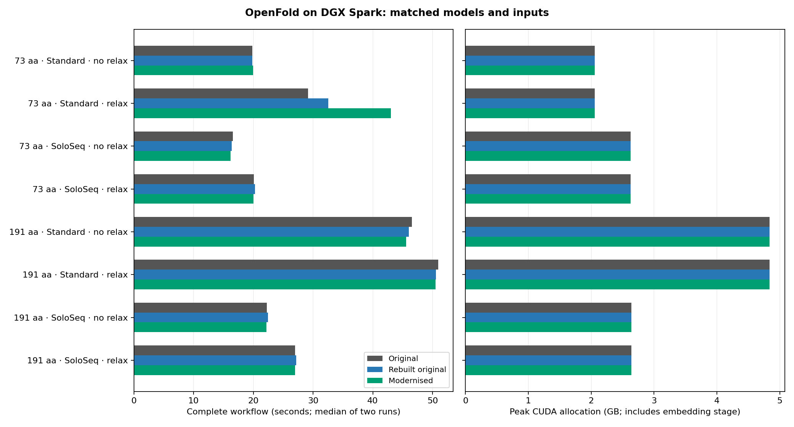

# OpenFold rebuild and dependency modernisation — 25 October 2026

The original deployment was rebuilt from public downloads and compared with a separate dependency-modernised image on DGX Spark. All three conditions completed the eight published benchmark configurations, with one warm-up and two measured runs per configuration. Embedding generation was measured separately for each protein and condition.

The input FASTA files contain **73 and 191 residues**. The previous README labels of 35 and 152 were incorrect. Historical timings are retained as historical observations; this is a newly controlled comparison.

## Runtime

Seconds, medians of two runs. SoloSeq workflow time includes a separately timed embedding-generation process plus inference/relaxation. It does not include initial software/model downloads or image building. All conditions used identical saved embeddings for the controlled inference comparison; separately generated embeddings were checked for agreement.

| Residues | Mode | Relaxation | Original | Rebuilt original | Modernised |
|---:|---|:---:|---:|---:|---:|
| 73 | Standard | No | 19.87 | 19.84 | 19.98 |
| 73 | Standard | Yes | 29.17 | 32.53 | 43.04 |
| 73 | SoloSeq | No | 16.56 | 16.40 | 16.18 |
| 73 | SoloSeq | Yes | 20.11 | 20.27 | 20.03 |
| 191 | Standard | No | 46.54 | 46.02 | 45.58 |
| 191 | Standard | Yes | 50.92 | 50.55 | 50.48 |
| 191 | SoloSeq | No | 22.27 | 22.45 | 22.17 |
| 191 | SoloSeq | Yes | 26.99 | 27.18 | 26.99 |

## Peak memory

GB decimal. Each cell is **CUDA allocated / main-process RSS**. Values are the maximum observed across the two measured runs and, for SoloSeq, both sequential workflow stages. These measures overlap on unified-memory hardware and must not be added. RSS is process memory, not total machine RAM; the raw records also contain CUDA reserved memory and sampled whole-system memory.

| Residues | Mode | Relaxation | Original | Rebuilt original | Modernised |
|---:|---|:---:|---:|---:|---:|
| 73 | Standard | No | 2.06 / 3.04 | 2.06 / 3.04 | 2.06 / 3.07 |
| 73 | Standard | Yes | 2.06 / 3.22 | 2.06 / 3.22 | 2.06 / 3.24 |
| 73 | SoloSeq | No | 2.63 / 10.93 | 2.63 / 10.94 | 2.63 / 11.00 |
| 73 | SoloSeq | Yes | 2.63 / 10.93 | 2.63 / 10.94 | 2.63 / 11.00 |
| 191 | Standard | No | 4.84 / 3.13 | 4.84 / 3.14 | 4.84 / 3.17 |
| 191 | Standard | Yes | 4.84 / 3.44 | 4.84 / 3.44 | 4.84 / 3.45 |
| 191 | SoloSeq | No | 2.64 / 10.93 | 2.64 / 10.94 | 2.64 / 11.00 |
| 191 | SoloSeq | Yes | 2.64 / 10.93 | 2.64 / 10.94 | 2.64 / 11.00 |

## Prediction agreement and limitations

- All 16 measured unrelaxed PDB outputs matched the original byte-for-byte in the rebuilt image, and all 16 matched in the modernised image. This is output agreement on these fixtures, not a new biological-accuracy benchmark.
- GPU relaxation was not byte-repeatable within the original image. The low-confidence short Standard prediction showed particularly large relaxation variability: the original’s two measured relaxed structures differed by about 5.18 Å Cα RMSD and had Cα lDDT 0.436. The same unrelaxed structure entered minimisation each time.
- Fixing preparation seeds and enabling deterministic CUDA forces did not make GPU relaxation byte-repeatable in the focused follow-up. The documented deterministic verification therefore explicitly skips relaxation. Normal inference defaults are unchanged.
- Relaxation time is variable; the short Standard relaxation result must not be interpreted as a general runtime regression or improvement from only two repetitions. Paired and within-image structural measurements are included in the JSON records.
- The modernised build uses the same current upstream OpenFold source revision and the same model weights as the original. It updates OpenMM to published 8.6.1 CUDA 13 ARM64 wheels and DeepSpeed to 0.19.8; it is not a newer trained model. DeepSpeed attention remains disabled in these preset/default comparisons.
- Inputs, alignments, templates, seeds and precision were fixed. The expandable CUDA allocator was set before CUDA initialisation. Peak CUDA memory and process RSS are recorded independently; the historical README whole-machine memory numbers use a different measurement convention.
- The tests cover these two monomers only. Maximum supported size, multimer performance, alternative attention backends and accuracy against experimental structures were not established.

Raw measurements and comparison records are in [data/](data/). Build identities, download checksums, deterministic verification instructions and the scope of each check are described in [reproducibility.md](reproducibility.md).
